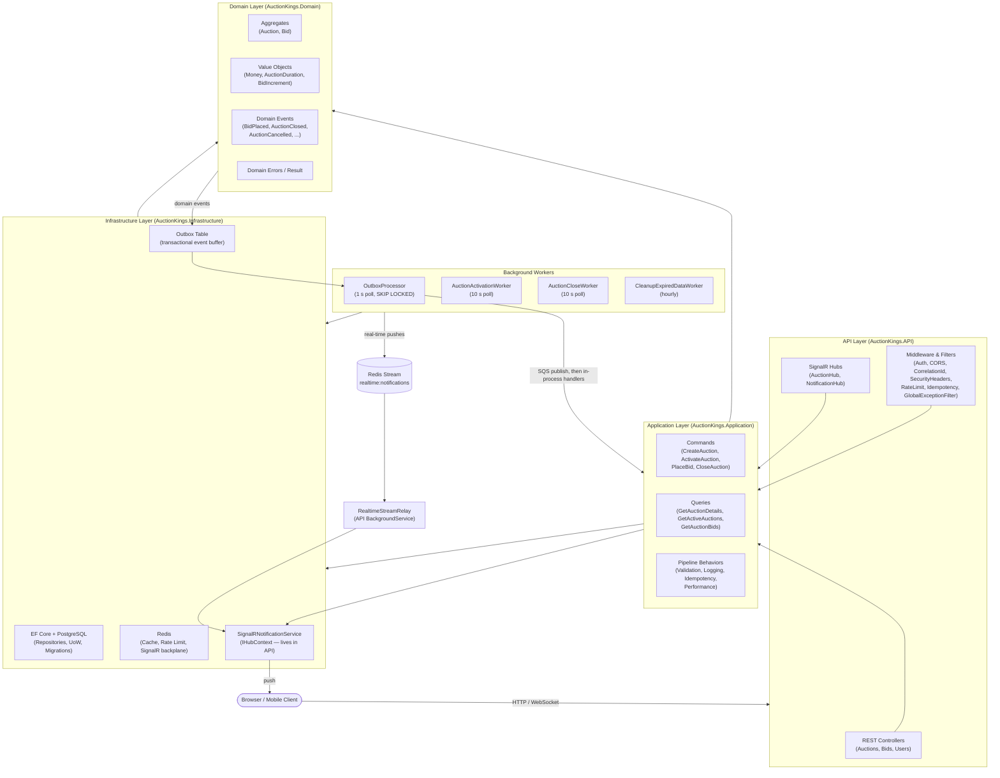

# AuctionKings — Architecture

---

## Table of Contents

1. [System Summary](#1-system-summary)
2. [Layer Diagram](#2-layer-diagram)
3. [Domain Model (DDD)](#3-domain-model-ddd)
4. [CQRS with MediatR](#4-cqrs-with-mediatr)
5. [Outbox Pattern](#5-outbox-pattern)
6. [SignalR Real-Time Layer](#6-signalr-real-time-layer)
7. [Concurrency, Idempotency, and Auth](#7-concurrency-idempotency-and-auth)
8. [Rate Limiting](#8-rate-limiting)
9. [Observability](#9-observability)
10. [Infrastructure — Local Docker Stack](#10-infrastructure--local-docker-stack)
11. [AWS Staging Architecture](#11-aws-staging-architecture)
12. [AWS Production Roadmap — v2.0](#12-aws-production-roadmap--v20)
13. [Key Design Decisions](#13-key-design-decisions)

---

## 1. System Summary

AuctionKings is a real-time auction platform built with .NET 10 / ASP.NET Core 10. It supports thousands of concurrent bidders, guarantees data consistency under high concurrency, and delivers sub-second bid notifications over WebSockets.

| Concern | Technology |
|---|---|
| API / Hubs | ASP.NET Core 10 — REST + SignalR |
| Application logic | MediatR (CQRS) + FluentValidation |
| Persistence | PostgreSQL 16 via EF Core 10 |
| Cache / Rate limiting | Redis 7 |
| Real-time backplane | Redis (SignalR) |
| Worker-to-API real-time | Redis Stream relay (ADR-011) |
| Event delivery | Transactional Outbox → AWS SQS |
| Auth (current) | JWT HS256, signing key from configuration (never committed, ADR-006) |
| Auth (roadmap) | AWS Cognito (RS256) |
| Logging | Serilog — structured JSON |
| Background workers | .NET Worker Service |
| Local infra | Docker (PostgreSQL, Redis, LocalStack, Moto, Prometheus, Grafana) |
| Cloud target | AWS ECS Fargate, RDS, ElastiCache, SQS/SNS |

---

## 2. Layer Diagram



**Dependency rule:** The domain has zero outward dependencies. Architecture tests (NetArchTest) enforce this at build time.

---

## 3. Domain Model (DDD)

### Aggregates

| Aggregate | Aggregate Root | Key entities / VOs |
|---|---|---|
| Auction | `Auction` | `Bid` (entity), `Money`, `AuctionDuration`, `BidIncrement` |

Aggregate methods report rule violations as `Result` / `Result<T>`, never by throwing (ADR-010); an architecture test enforces it. The value-object constructors (`Money`, `AuctionDuration`) still throw on invalid input.

### Auction lifecycle

```
Pending ──Activate (StartTime reached)──► Active ──Close (EndTime reached)──► Closed
   │                                        │
   └──────────────── Cancel ────────────────┘──► Cancelled
```

- `Create` returns `Active` when `StartTime` is now or earlier, otherwise `Pending`.
- `AuctionActivationWorker` activates `Pending` auctions that are due. `Activate` rejects one that already ended (`Auction.Ended`); `ActivateAuctionCommandHandler` then **cancels** it, so it leaves the pending set instead of failing on every poll.
- `AuctionCloseWorker` closes `Active` auctions past `EndTime`.
- `Cancel` is not exposed through any controller yet; who may cancel an auction is an open product decision.

### Key domain rules (enforced in `Auction.PlaceBid`)

- Auction must be `Active` and not past `EndTime`.
- The seller cannot bid on their own auction, and the bid currency must match the auction's.
- The current winner cannot outbid themselves.
- The bid must reach the minimum from `BidIncrement.GetMinimumBid(CurrentPrice)`, not merely exceed the current price.
- **Anti-sniping:** if a bid arrives when less than 5 minutes remain, `EndTime` extends by 5 minutes and an `AuctionExtendedEvent` is raised.
- Every state change increments `Auction.Version`, the optimistic-concurrency token (see section 7).

### Domain Events

All events implement `IDomainEvent` and are collected on `AggregateRoot`. They are not dispatched at the moment they are raised: they are serialised into the Outbox table within the same database transaction as the state change and dispatched asynchronously by `OutboxProcessor` (section 5).

| Event | Trigger |
|---|---|
| `AuctionCreatedEvent` | New auction persisted |
| `AuctionActivatedEvent` | Pending auction becomes Active |
| `BidPlacedEvent` | Successful bid |
| `AuctionExtendedEvent` | Anti-sniping extension |
| `AuctionClosedEvent` | Auction finalised |
| `WinnerDeterminedEvent` | Winner resolved after close |
| `AuctionCancelledEvent` | Auction cancelled (only on a real state change) |

---

## 4. CQRS with MediatR

All use-cases flow through MediatR. Commands mutate state; queries are read-only and may hit the Redis cache before touching PostgreSQL.

### Commands

| Command | Description |
|---|---|
| `CreateAuctionCommand` | Create and persist a new auction |
| `PlaceBidCommand` | Validate and record a bid; raises `BidPlacedEvent` |
| `ActivateAuctionCommand` | Activate a due `Pending` auction; cancels one that ended without being activated (returns an `ActivationOutcome`) |
| `CloseAuctionCommand` | Transition auction to `Closed`; raises `AuctionClosedEvent` |

### Queries

| Query | Description |
|---|---|
| `GetAuctionDetailsQuery` | Single auction with bids (cache-first) |
| `GetActiveAuctionsQuery` | Paginated list of active auctions |
| `GetAuctionBidsQuery` | Bid history for a given auction |

### Query caching and invalidation

Query results are cached in Redis in **scopes** (`CacheScopes`): one per auction (its details and bid pages), one for the active listings, and one per user's bid history. Commands invalidate a scope after their transaction commits (`ICacheInvalidationService`).

Invalidation never scans or deletes keys. Each scope has a random version marker (`cachever:{scope}`) and every entry is stored as `{version}|{json}`; replacing the marker makes all older entries misses, and they expire on their own. This is constant time, uses only single-key Redis commands (safe on Redis Cluster), and a reader that loaded data before an invalidation cannot re-cache it, because its version was captured before the load. The cache fails open: if Redis is unavailable, queries read from PostgreSQL. See ADR-009.

### Pipeline Behaviors (ordered)

1. **LoggingBehavior** — structured entry/exit logs with elapsed ms.
2. **ValidationBehavior** — FluentValidation; returns `Result.Failure` on error.
3. **IdempotencyBehavior** — Redis cache + DB store keyed on `X-Request-Id` (24 h TTL).
4. **PerformanceBehavior** — warning log when handler exceeds 500 ms.

---

## 5. Outbox Pattern

**Problem:** Domain events must be delivered even if the process crashes between saving state and publishing events.

**Solution:** Events are serialised as `OutboxMessage` rows and written in the same `SaveChangesAsync` transaction as the aggregate state. A background processor polls and dispatches them.

```
PlaceBid command
    └─► Auction.PlaceBid()              (domain)
            └─► AddDomainEvent(BidPlacedEvent)
    └─► UnitOfWork.SaveChangesAsync()   (infrastructure)
            ├─► INSERT INTO auctions ... (state)
            └─► INSERT INTO outbox_messages ... (event)
                    ── single PostgreSQL transaction ──

OutboxProcessor (every 1 s by default)
    └─► SELECT ... FOR UPDATE SKIP LOCKED  (20 rows, no double-processing)
    └─► Deserialise the event
    └─► IEventBus.PublishAsync()     → AWS SQS (bid-events queue)
    └─► In-process handlers          → MediatR, events wrapped in DomainEventNotification<T>
    └─► SET processed_at = now
```

**Order matters.** SQS is published first and the in-process handlers run afterwards. The processor retries the whole message when any step throws; handlers (for example `NotifySellerOnAuctionCancelled`) are best-effort side effects, so running them before a failing SQS publish would repeat them on every retry. Handlers should therefore swallow and log their own failures. Domain events are not MediatR notifications (Domain has no MediatR reference), hence the `DomainEventNotification<TEvent>` adapter in the Application layer.

**Retry policy:** `MaxRetries` (default 3) attempts per message; the row keeps `RetryCount` and is then marked `Failed`. Defaults are batch size 20 and a 1 s poll, bound from the `Outbox` section (`OutboxOptions.SectionName`). The worker's `appsettings.json` puts `PollingIntervalSeconds: 5` under a section named `OutboxProcessor`, which nothing binds, so the effective poll is 1 s until that section is renamed. SKIP LOCKED makes concurrent processing safe across multiple worker replicas. A circuit breaker for a failing SQS is not implemented (ADR-003).

---

## 6. SignalR Real-Time Layer

### Two hubs

| Hub | Purpose |
|---|---|
| `AuctionHub` | Per-auction groups (`auction-{id}`): `BidPlaced`, `AuctionClosed`; `AuctionExtended` is wired (`NotifyAuctionExtendedAsync`, relay kind) but nothing sends it yet — `PlaceBidCommandHandler` does not push anti-sniping extensions and `AuctionExtendedEvent` has no handler, so clients see a new `EndTime` only after `RequestStateSync`/reload |
| `NotificationHub` | Per-user group (`user-{userId}`): notices addressed to one user, for example `AuctionCancelled` to the seller |

Bidder identities are never pushed: `BidPlaced` carries the auction id, bid id, amount and currency only (ADR-005).

### Scaling with Redis backplane

All hub instances share the Redis backplane (`StackExchangeRedis` provider). Group broadcasts (`auction-{id}`) fan out across all API replicas transparently.

### Worker-to-API notifications (Redis Stream relay)

The background worker hosts no SignalR, yet some pushes originate there (`AuctionClosed` from the close worker, the seller's cancellation notice from an outbox handler). In the worker, `IRealtimeNotificationService` is `RedisStreamRealtimeNotificationService`: it appends a versioned JSON envelope to the Redis Stream `realtime:notifications`. In the API, `RealtimeStreamRelay` reads the stream through the consumer group `api` and calls the SignalR-backed `SignalRNotificationService`.

- One consumer group means each entry reaches exactly one API replica (Pub/Sub would make every replica re-send it through the backplane).
- At-least-once: an entry is acknowledged after it was handled; entries stuck with a crashed replica are taken over by another (`XAUTOCLAIM`). Malformed, unknown, unsupported-version, stale (> 10 min by default) or failing entries are logged and dropped.
- The stream is capped at about 10,000 entries; the relay is tuned through the `RealtimeRelay` configuration section.
- Redis is not durable by default and the relay polls every 500 ms when idle: this path is for UI pushes, not for anything that must not be lost (that belongs in the outbox).

See ADR-011.

### State sync on reconnect

When a client calls `JoinAuction`, the hub validates that the auction exists, adds the connection to the auction's group and sends the current auction details (the `GetAuctionDetailsQuery` result) as an `AuctionState` message. After a reconnect, `RequestStateSync` sends it again.

### Throttling and abuse limits

Both hubs share one global `HubThrottlingFilter` (an `IHubFilter`), configured by the `HubThrottling` section:

| Limit | Default | Behaviour when exceeded |
|---|---|---|
| Hub method invocations per user | 20 per 10 s, across all connections and hubs | the call throws `HubException("Rate limit exceeded…")`; the connection stays open |
| Concurrent connections per user | 10 (both hubs share one count) | the new connection is aborted |
| Auctions joined per connection | 20 | `JoinAuction` throws `HubException` |
| Client message size | 8 KB | SignalR closes the connection |

Invocations are counted per user in Redis (sliding window, same limiter as REST) and fail open if Redis is unreachable. `JoinAuction` validates that the auction exists before adding the connection to its group, and SignalR runs one invocation at a time per connection (`MaximumParallelInvocationsPerClient = 1`). See ADR-007.

### SignalR placement note

`SignalRNotificationService` (which uses `IHubContext<AuctionHub>` and `IHubContext<NotificationHub>`) lives in the **API project**, not Infrastructure. This avoids a circular project dependency (Infrastructure → API). It is registered as `IRealtimeNotificationService` in the API and consumed by Application-layer handlers; the worker registers the stream-backed implementation instead (see above).

---

## 7. Concurrency, Idempotency, and Auth

### Optimistic concurrency via `Auction.Version`

`Auction.Version` is an integer column that every state change increments, and EF Core uses it as the concurrency token. On `UPDATE`, EF adds `WHERE version = <loaded value>`; if another transaction changed the row first, no row matches and EF raises `DbUpdateConcurrencyException`. `UnitOfWork` translates it into `ConcurrencyException`.

`PlaceBidCommandHandler` retries: it clears the change tracker, reloads the auction, re-validates the bid and tries again. When the retries run out it returns `DomainErrors.Auction.ConcurrencyConflict` (HTTP 409).

PostgreSQL's `xmin` was the original choice (ADR-001) but is not used: Npgsql 10 does not reliably read `xid` system columns back through `RETURNING`, so the tracked value stayed 0 and every update failed (see the comment in `AuctionConfiguration`).

### Idempotency

`BidsController.PlaceBid` is marked `[Idempotent]`; the globally registered `IdempotencyFilter` requires a GUID in the `X-Request-Id` header for such actions. The controller derives the command's idempotency key as `{UserId}:{AuctionId}:{RequestId}`, so one user cannot replay another's request.

`IdempotencyBehavior<TRequest, TResponse>` handles commands that implement `IIdempotentCommand`:

1. Redis cache (fast path, 24 h TTL): a stored response is replayed with no side effects.
2. Atomic reservation of the key in the PostgreSQL `IdempotencyStore` (survives cache eviction). A completed duplicate replays the stored response; a duplicate whose first request is still in flight raises `DuplicateCommandException` (HTTP 409).

### JWT Authentication (current)

Local HS256 tokens. The signing key comes from `Jwt:Secret`; the API refuses to start if it is missing, shorter than 32 bytes or the old placeholder, and no key is committed (ADR-006). The `sub` claim carries the user ID, and the policies are `Bidder` and `Admin`. SignalR clients that cannot set headers on a WebSocket pass the token as the `access_token` query parameter, which is read only for paths under `/hubs`.

### JWT Authentication (roadmap — AWS Cognito)

RS256 tokens issued by Cognito User Pools. See [cognito-integration.md](cognito-integration.md) for the full migration guide. **None of this is implemented yet.** The local Moto stack provisions a Cognito pool for experiments, but the API validates only its own HS256 tokens.

The planned Cognito auth layer adds:
- **Token revocation:** `RedisTokenBlacklistService` checks the `jti` claim against a Redis key per revoked token. `RevokeAllUserTokensAsync` stores a `revoke_before` timestamp per user for global sign-out.
- **Claim enrichment:** On token validation, the user profile is fetched and `reputation`, `is_verified`, and `total_bids` claims are added to the principal.
- **Authorization policies:** `CanBid` (email verified + minimum reputation score), `CanCreateAuction`, and `HighValueBid` (MFA or KYC required for bids above $10,000) — enforced via `IAuthorizationHandler`.

---

## 8. Rate Limiting

### Current implementation

`[RateLimit(policy, retryAfterSeconds, failOpen)]` is an action filter backed by the Redis `IRateLimiter`. It is applied to `BidsController.PlaceBid` (policy `place-bid`) and `AuctionsController.CreateAuction` (policy `create-auction`).

- **Key:** `rate:{policy}:{userId}`, falling back to the client IP when unauthenticated.
- **Limit:** `RateLimit:MaxRequests` per `RateLimit:Window` (defaults 10 per 10 s).
- **Failure mode:** both write endpoints use `failOpen: false`: if Redis is unavailable they answer **503** instead of letting requests through. The hub throttling filter uses the same limiter and fails open (ADR-007).
- **Responses:** `X-RateLimit-Limit` and `X-RateLimit-Remaining` on every response; on a rejection, **429** with `Retry-After`.

### Algorithm — distributed sliding window (Redis Lua)

An atomic Lua script runs on Redis to avoid races across API instances:

```
1. Remove expired entries from the sorted set: ZREMRANGEBYSCORE key -inf (now - window_ms)
2. Count current entries: ZCARD key
3. If count < limit:
       Add a unique member scored by the timestamp (INCR on a sequence key): ZADD key now <now:seq>
       Set TTL on both keys: PEXPIRE key window_ms
       Return: allowed, current count = count + 1
   Else:
       Return: denied, current count = count
```

---

## 9. Observability

### Serilog structured JSON logging

- All logs are emitted as structured JSON (enriched with `CorrelationId`, `UserId`, request path, elapsed ms).
- Serilog request logging (`UseSerilogRequestLogging`) records every HTTP request, and `CorrelationIdMiddleware` assigns the correlation id.
- `LoggingBehavior` records every MediatR command/query with timing.
- In production the sink targets AWS CloudWatch Logs.

### Health endpoints

| Endpoint | Checks |
|---|---|
| `GET /health/live` | Process liveness only |
| `GET /health/ready` | PostgreSQL + Redis + Outbox backlog |
| `GET /health/db` | Database connectivity only |

### Prometheus metrics

`GET /metrics` exposes a Prometheus-format endpoint via `prometheus-net.AspNetCore`. Three custom metrics are tracked:

| Metric | Type | Description |
|---|---|---|
| `http_request_duration_seconds` | Histogram | Per-route HTTP latency (auto via `UseHttpMetrics`) |
| `auction_kings_bids_placed_total` | Counter | Successful bids since startup |
| `auction_kings_outbox_pending_messages_count` | Gauge | Pending outbox messages per batch |

### Grafana dashboard

An "AuctionKings Overview" dashboard is auto-provisioned in Grafana (`docker/grafana/provisioning/`). It includes panels for request rate, p50/p99 latency, status-code breakdown, bids-placed rate, and outbox lag. Grafana is available at `http://localhost:3000` (user `admin`, password generated by `./scripts/setup-local-env.sh` in `docker/secrets/grafana_admin_password.txt`) when running the infra compose stack.

---

## 10. Infrastructure — Local Docker Stack

```
docker/docker-compose.infra.yml
    ├── PostgreSQL 16      :5432  (DB: AuctionKingsDB, user: dev)
    ├── Redis 7            :6379
    ├── LocalStack 4.14    :4566  (SQS, SNS, S3, DynamoDB, Secrets Manager, Logs)
    ├── Moto 5.2.5         :5555  (Cognito, AppConfig, EventBridge)
    ├── aws-cli (init)            provisions both emulators, then exits
    ├── Prometheus         :9090  (scrapes /metrics every 15 s)
    └── Grafana            :3000  (auto-provisioned dashboard)
```

Of the AWS services provisioned locally, only SQS is used by the application code today; the rest are provisioned for the roadmap.

See the [Runbook](runbook.md) for operational commands, health check details, and troubleshooting.

---

## 11. AWS Staging Architecture

The staging environment is provisioned with Terraform (`infra/terraform/staging/`) and deployed via GitHub Actions OIDC. It consists of:

```
ALB (public, HTTP :80)
    └─► ECS Fargate (auction-kings-staging cluster)
            │  API task:    0.25 vCPU / 512 MB — logs → CloudWatch /ecs/auction-kings-staging-api
            │  Worker task: 0.25 vCPU / 512 MB — logs → CloudWatch /ecs/auction-kings-staging-worker
            │  Images from GHCR: ghcr.io/<owner>/<repo>-api and -worker
            │
            ├─► RDS PostgreSQL 16 (db.t4g.micro, encrypted, private subnet)
            ├─► ElastiCache Redis 7 (cache.t4g.micro, TLS + AUTH, private subnet)
            ├─► SQS bid-events queue + DLQ
            └─► Secrets Manager (DB password, Redis AUTH, JWT secret,
                                 MediatR license: created empty, value set out of band)
```

The pipeline is `CI` → `Publish Docker Images` → `Infrastructure – Staging` (Terraform plan/apply) → `Deploy to Staging`; each stage runs after the previous one succeeds. The task definitions do not read the MediatR secret yet.

GitHub OIDC → `AssumeRoleWithWebIdentity` is used for the deploy workflow — no long-lived AWS access keys in CI.

---

## 12. AWS Production Roadmap — v2.0

### Target infrastructure

```
CloudFront (CDN)
    └─► ALB
            ├─► API Service          (ECS Fargate, multi-AZ)
            ├─► SignalR Service      (ECS Fargate, Redis backplane)
            └─► Worker Service       (ECS Fargate)
                    │
                    ├─► RDS PostgreSQL 16 Multi-AZ
                    ├─► ElastiCache Redis 7 cluster mode
                    ├─► DynamoDB          (event store)
                    ├─► SNS / EventBridge (fan-out messaging)
                    ├─► AWS Cognito       (RS256 auth)
                    ├─► Secrets Manager  (rotation enabled)
                    └─► CloudWatch + X-Ray (logs, metrics, traces)
```

### Event Sourcing with DynamoDB snapshots

Domain events will be stored in DynamoDB as an immutable event stream alongside the PostgreSQL write model. Two tables: `AuctionEvents` (stream ID + version as composite key) and `AuctionSnapshots`.

Snapshots are created every 50 events to avoid full stream replay on aggregate hydration. Load sequence: fetch latest snapshot → load events after snapshot version → replay incrementally onto the aggregate.

Optimistic concurrency at the DynamoDB level: writes use a `ConditionExpression` that rejects the put if the version already exists, preventing concurrent event appends.

### Saga pattern — auction closing

Auction close triggers a persisted `AuctionClosingSaga` that coordinates across services with compensating transactions:

| Step | Action | Compensation |
|---|---|---|
| 1 | Determine winner | Reopen auction |
| 2 | Reserve payment | Release payment reservation |
| 3 | Reserve item in inventory | Release item |
| 4 | Notify winner, losers, and seller | — |

Saga state (`AuctionClosingSagaState`) is persisted after every step. On failure, compensation runs in reverse order. Status values: `Started → DeterminingWinner → ReservingPayment → ReservingItem → NotifyingParticipants → Completed`. Failure paths: `Compensating → Failed`.

### Frontend — Blazor WebAssembly

Planned frontend: Blazor WebAssembly served via CloudFront. Connects to `AuctionHub` via SignalR for real-time bid updates.

### Distributed tracing

AWS X-Ray tracing for ECS Fargate deployments (planned). Correlates HTTP requests, MediatR commands, and database queries across service boundaries.

---

## 13. Key Design Decisions

Full context, consequences, and trade-offs for each ADR are in [decisions.md](decisions.md).

| ADR | Decision | Why |
|---|---|---|
| ADR-001 | Optimistic concurrency token on `Auction` (originally PostgreSQL `xmin`; implemented as the app-level `Version` column) | Concurrent bids cannot both win; see the note in ADR-001 |
| ADR-002 | Outbox Pattern for domain event delivery | At-least-once delivery even on a crash between DB commit and publish |
| ADR-003 | Documented system limits | Page sizes, rate limit, outbox and JWT defaults in one place |
| ADR-004 | Explicit CORS origin allowlist | No cross-origin browser access unless an origin is listed |
| ADR-005 | Bidding is never public | Bidder identities are never exposed to other users |
| ADR-006 | No signing secrets in source control | The JWT key comes from configuration and is validated at startup |
| ADR-007 | SignalR throttling | Per-user invocation, connection, group and message-size limits |
| ADR-008 | Atomic connection tracking | Lua scripts keep the connection sets consistent and expiring |
| ADR-009 | Versioned cache scopes | Constant-time invalidation without scanning keys |
| ADR-010 | Aggregates report rule violations as `Result` | One error contract for the domain |
| ADR-011 | Worker-to-API real-time notifications over a Redis Stream | The worker has no SignalR; one replica delivers each push |
