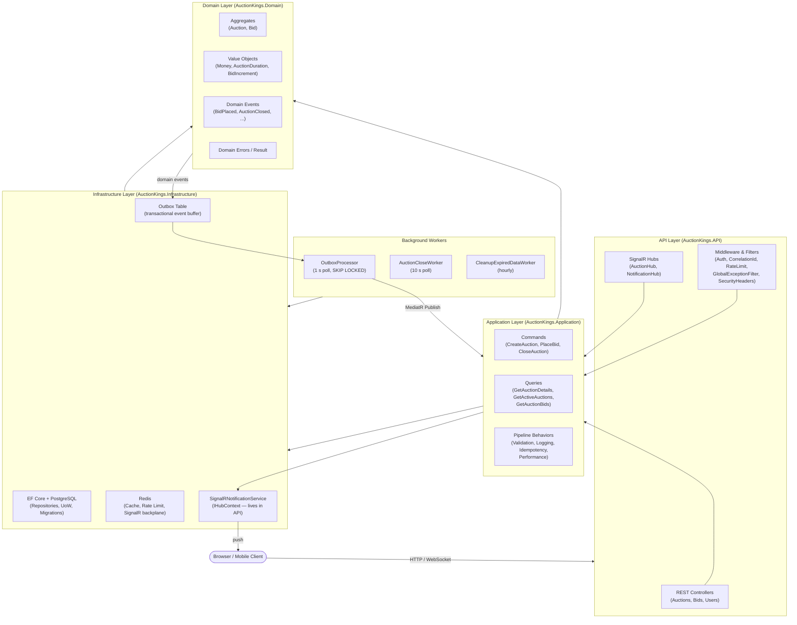

# AuctionKings — Architecture Overview

> **Full v2.0 spec and AWS roadmap:** [`/architecture/ARCHITECTURE.md`](/architecture/ARCHITECTURE.md)

---

## Table of Contents

1. [System Summary](#1-system-summary)
2. [Layer Diagram](#2-layer-diagram)
3. [Clean Architecture Layers](#3-clean-architecture-layers)
4. [Domain Model (DDD)](#4-domain-model-ddd)
5. [CQRS with MediatR](#5-cqrs-with-mediatr)
6. [Outbox Pattern](#6-outbox-pattern)
7. [SignalR Real-Time Layer](#7-signalr-real-time-layer)
8. [Concurrency, Idempotency, and Auth](#8-concurrency-idempotency-and-auth)
9. [Observability](#9-observability)
10. [Infrastructure (Local and AWS)](#10-infrastructure-local-and-aws)
11. [Key Design Decisions (ADRs)](#11-key-design-decisions-adrs)

---

## 1. System Summary

AuctionKings is a real-time auction platform built with .NET 10 / ASP.NET Core 10. It supports thousands of concurrent bidders, guarantees data consistency under high concurrency, and delivers sub-second bid notifications over WebSockets.

| Concern | Technology |
|---|---|
| API / Hubs | ASP.NET Core 10 — REST + SignalR |
| Application logic | MediatR (CQRS) + FluentValidation |
| Persistence | PostgreSQL 16 via EF Core 10 |
| Cache / Rate limiting | Redis 7 |
| Real-time backplane | Redis (SignalR) |
| Auth (current) | JWT HS256 — dev only |
| Auth (roadmap) | AWS Cognito (RS256) |
| Logging | Serilog — structured JSON |
| Background workers | .NET Worker Service |
| Local infra | Docker (PostgreSQL, Redis, LocalStack, Moto) |
| Cloud target | AWS ECS Fargate, RDS, ElastiCache, SQS/SNS |

---

## 2. Layer Diagram



---

## 3. Clean Architecture Layers

```
┌──────────────────────────────────────────────────────┐
│  API Layer  (Controllers · Hubs · Filters · Middleware)
│  depends on → Application                             │
└──────────────────────────────────────────────────────┘
               │
               ▼
┌──────────────────────────────────────────────────────┐
│  Application Layer  (Commands · Queries · Behaviors)  │
│  defines interfaces, depends on → Domain              │
└──────────────────────────────────────────────────────┘
               │                        ▲
               ▼                        │ implements
┌────────────────────┐     ┌────────────────────────────┐
│  Domain Layer      │     │  Infrastructure Layer       │
│  Pure C# — no      │     │  EF Core · Redis · Workers  │
│  framework deps    │     │  implements App interfaces  │
└────────────────────┘     └────────────────────────────┘
```

**Dependency rule:** domain has zero outward dependencies. Infrastructure and API reference the inner layers; inner layers never reference outer layers. Architecture tests (NetArchTest) enforce this at build time.

---

## 4. Domain Model (DDD)

### Aggregates

| Aggregate | Aggregate Root | Key entities / VOs |
|---|---|---|
| Auction | `Auction` | `Bid` (entity), `Money`, `AuctionDuration`, `BidIncrement` |
| User | `User` | `UserProfile` |

### Key domain rules (enforced in `Auction.PlaceBid`)

- Auction must be `Active` and not past `EndTime`.
- Bid amount must exceed `CurrentPrice`.
- The current winner cannot outbid themselves.
- **Anti-sniping:** if a bid arrives within the last 30 seconds, `EndTime` extends by 2 minutes and an `AuctionExtendedEvent` is raised.

### Domain Events

All events implement `IDomainEvent` and are collected on `AggregateRoot`. They are never dispatched in-process — they are serialised into the Outbox table within the same database transaction and dispatched asynchronously.

| Event | Trigger |
|---|---|
| `AuctionCreatedEvent` | New auction persisted |
| `BidPlacedEvent` | Successful bid |
| `AuctionExtendedEvent` | Anti-sniping extension |
| `AuctionClosedEvent` | Auction finalised |
| `WinnerDeterminedEvent` | Winner resolved after close |

---

## 5. CQRS with MediatR

All use-cases flow through MediatR. Commands mutate state; queries are read-only and may hit the Redis cache before touching PostgreSQL.

### Commands

| Command | Description |
|---|---|
| `CreateAuctionCommand` | Create and persist a new auction |
| `PlaceBidCommand` | Validate and record a bid; raises `BidPlacedEvent` |
| `CloseAuctionCommand` | Transition auction to `Closed`; raises `AuctionClosedEvent` |

### Queries

| Query | Description |
|---|---|
| `GetAuctionDetailsQuery` | Single auction with bids (cache-first) |
| `GetActiveAuctionsQuery` | Paginated list of active auctions |
| `GetAuctionBidsQuery` | Bid history for a given auction |

### Pipeline Behaviors (ordered)

1. **LoggingBehavior** — structured entry/exit logs with elapsed ms.
2. **ValidationBehavior** — FluentValidation; returns `Result.Failure` on error.
3. **IdempotencyBehavior** — Redis cache + DB store keyed on `X-Request-Id` (24 h TTL).
4. **PerformanceBehavior** — warning log when handler exceeds 500 ms.

---

## 6. Outbox Pattern

**Problem:** Domain events must be delivered even if the process crashes between saving state and publishing events.

**Solution:** Events are serialised as `OutboxMessage` rows and written in the same `SaveChangesAsync` transaction as the aggregate state. A background processor polls and dispatches them.

```
PlaceBid command
    └─► Auction.PlaceBid()              (domain)
            └─► AddDomainEvent(BidPlacedEvent)
    └─► UnitOfWork.SaveChangesAsync()   (infrastructure)
            ├─► INSERT INTO auctions ... (state)
            └─► INSERT INTO outbox_messages ... (event)
                    ── single PostgreSQL transaction ──

OutboxProcessor (every 1 s)
    └─► SELECT ... FOR UPDATE SKIP LOCKED  (100 rows, no double-processing)
    └─► Deserialise + MediatR.Publish()
    └─► SET processed_at = NOW()
```

**Retry policy:** up to 5 retries; error message stored on the row. SKIP LOCKED ensures safe concurrent processing across multiple worker replicas.

---

## 7. SignalR Real-Time Layer

### Two hubs

| Hub | Purpose |
|---|---|
| `AuctionHub` | Per-auction groups — bid updates, price changes, auction close |
| `NotificationHub` | Per-user channel — winner/loser notifications |

### Scaling with Redis backplane

All hub instances share the Redis backplane (`StackExchangeRedis` provider). Group broadcasts (`auction:{id}`) fan out across all API replicas transparently.

### State sync on reconnect

When a client calls `JoinAuction`, the hub sends the full current `AuctionStateDto` (price, winner, bid count, last 10 bids, server time, version). If the client version is behind after a reconnect, `RequestStateSync` triggers a full refresh.

### SignalR placement note

`SignalRNotificationService` (which uses `IHubContext<AuctionHub>`) lives in the **API project**, not Infrastructure. This avoids a circular project dependency (Infrastructure → API). It is registered as `IRealtimeNotificationService` and consumed by Application-layer event handlers.

### Graceful shutdown

`GracefulShutdownService` sends a `ServerShuttingDown` message to all connected clients before the process exits, instructing them to reconnect with a 1-second delay.

---

## 8. Concurrency, Idempotency, and Auth

### Optimistic concurrency via PostgreSQL `xmin`

EF Core maps the `xmin` system column (type `xid`) as the concurrency token on the `Auction` entity. On every `UPDATE`, PostgreSQL automatically rejects writes where `xmin` changed since the row was read, and EF Core raises `DbUpdateConcurrencyException`. The handler returns `DomainErrors.Bid.ConcurrentModification` (HTTP 409) and the client retries.

No application-managed version counter is needed; the database itself is the authority.

### Idempotency

The `X-Request-Id` header carries a client-generated UUID per request. `IdempotencyBehavior<TRequest, TResponse>` checks:

1. Redis cache (fast path, 24 h TTL).
2. Persistent `IdempotencyStore` in PostgreSQL (survives cache eviction).

If found, the stored response is returned immediately with no side effects. `PlaceBidCommand` derives its idempotency key as `{UserId}:{AuctionId}:{RequestId}`.

### JWT Authentication (current — dev)

Local HS256 tokens. The `sub` claim carries the user ID. SignalR hubs prefer the `X-SignalR-Token` header or `signalr_token` cookie over the query-string access token (query-string usage is logged as a warning).

### JWT Authentication (roadmap — AWS Cognito)

RS256 tokens issued by Cognito User Pools. The handler enriches the `ClaimsPrincipal` with `reputation`, `is_verified`, and `total_bids` claims from the user profile. A `RedisTokenBlacklistService` checks the `jti` claim to support token revocation. Authorization policies (`CanBid`, `CanCreateAuction`, `HighValueBid`) are enforced via `IAuthorizationHandler`.

---

## 9. Observability

### Serilog structured JSON logging

- All logs are emitted as structured JSON (enriched with `CorrelationId`, `UserId`, request path, elapsed ms).
- `RequestLoggingMiddleware` records every HTTP request/response.
- `LoggingBehavior` records every MediatR command/query with timing.
- In production the sink targets AWS CloudWatch Logs.

### Health endpoints

| Endpoint | Checks |
|---|---|
| `GET /health/live` | Process liveness only |
| `GET /health/ready` | PostgreSQL + Redis + Outbox backlog |
| `GET /health/db` | Database connectivity only |

### Prometheus metrics

`GET /metrics` exposes a Prometheus-format endpoint via `prometheus-net.AspNetCore`. Three custom metrics are tracked:

| Metric | Type | Description |
|---|---|---|
| `http_request_duration_seconds` | Histogram | Per-route HTTP latency (auto via `UseHttpMetrics`) |
| `auction_kings_bids_placed_total` | Counter | Successful bids since startup |
| `auction_kings_outbox_pending_messages_count` | Gauge | Pending outbox messages per batch |

### Grafana dashboard

An "AuctionKings Overview" dashboard is auto-provisioned in Grafana (`docker/grafana/provisioning/`). It includes panels for request rate, p50/p99 latency, status-code breakdown, bids-placed rate, and outbox lag. Grafana is available at `http://localhost:3000` (admin / admin) when running the infra compose stack.

### Distributed tracing (roadmap)

AWS X-Ray distributed tracing for ECS Fargate deployments is planned for the production environment.

---

## 10. Infrastructure (Local and AWS)

### Local Docker stack

```
docker/docker-compose.infra.yml
    ├── PostgreSQL 16      :5432  (DB: AuctionKingsDB, user: dev)
    ├── Redis 7            :6379
    ├── LocalStack 4.3     :4566  (S3, SQS, SNS, DynamoDB emulation)
    ├── Moto 5.1.4         :5555  (Cognito emulation)
    ├── Prometheus         :9090  (scrapes /metrics every 15 s)
    └── Grafana            :3000  (auto-provisioned dashboard)
```

### AWS staging architecture (live)

The staging environment is provisioned with Terraform (`infra/terraform/staging/`) and deployed via GitHub Actions OIDC. It consists of:

```
ALB (public, HTTP :80)
    └─► ECS Fargate (auction-kings-staging cluster)
            │  Task: 0.25 vCPU / 512 MB — API container
            │  Logs → CloudWatch /ecs/auction-kings-staging-api
            │
            ├─► RDS PostgreSQL 16 (db.t4g.micro, encrypted, private subnet)
            ├─► ElastiCache Redis 7 (cache.t4g.micro, TLS + AUTH, private subnet)
            ├─► SQS bid-events queue + DLQ
            └─► Secrets Manager (DB password, Redis AUTH, JWT secret)
```

GitHub OIDC → `AssumeRoleWithWebIdentity` is used for the deploy workflow — no long-lived AWS access keys in CI.

### AWS production roadmap (v2.0)

```
CloudFront (CDN)
    └─► ALB
            ├─► API Service          (ECS Fargate, multi-AZ)
            ├─► SignalR Service      (ECS Fargate, Redis backplane)
            └─► Worker Service       (ECS Fargate)
                    │
                    ├─► RDS PostgreSQL 16 Multi-AZ
                    ├─► ElastiCache Redis 7 cluster mode
                    ├─► DynamoDB          (event store — future)
                    ├─► SNS / EventBridge (fan-out messaging — future)
                    ├─► AWS Cognito       (RS256 auth — see docs/cognito-integration.md)
                    ├─► Secrets Manager  (rotation enabled)
                    └─► CloudWatch + X-Ray (logs, metrics, traces)
```

---

## 11. Key Design Decisions (ADRs)

### ADR-01 — PostgreSQL `xmin` for optimistic concurrency

**Context:** Multiple concurrent bids arrive for the same auction. We need a concurrency guard without a separate application-managed version column.

**Decision:** Map PostgreSQL's built-in `xmin` system column as EF Core's concurrency token. Every row write increments `xmin` automatically at the database level.

**Consequences:** Zero schema overhead (no extra column). Concurrency violations surface as `DbUpdateConcurrencyException` which is caught and translated to HTTP 409. Works correctly with connection pooling. Not portable to non-PostgreSQL databases.

---

### ADR-02 — Outbox Pattern for domain event delivery

**Context:** Dispatching domain events in-memory after `SaveChanges` risks losing events if the process crashes between the DB commit and the publish call.

**Decision:** Serialise domain events as `outbox_messages` rows within the same database transaction as the aggregate state change. A background `OutboxProcessor` polls with `FOR UPDATE SKIP LOCKED`, deserialises each event, and publishes via MediatR.

**Consequences:** At-least-once delivery guarantee. Event handlers must be idempotent. Slight increase in write latency (additional rows per transaction). SKIP LOCKED enables safe horizontal scaling of the worker.

---

### ADR-03 — Idempotency via `X-Request-Id` + Redis cache + DB store

**Context:** Network retries and double-clicks can submit the same bid multiple times. The Outbox already guarantees at-least-once delivery; we additionally need exactly-once semantics at the HTTP layer.

**Decision:** Clients send a UUID in `X-Request-Id`. `IdempotencyBehavior` checks Redis first (fast path), then the DB store, and short-circuits with the stored response if the key is already known. The result is persisted to both stores with a 24-hour TTL.

**Consequences:** Duplicate requests are idempotent at zero DB cost on the hot path (Redis hit). The DB store protects against cache eviction. TTL means idempotency is not permanent — acceptable for bid operations.

---

### ADR-04 — `SignalRNotificationService` in the API project

**Context:** `SignalRNotificationService` must use `IHubContext<AuctionHub>`, which is defined in the API project. Placing it in Infrastructure would create a circular dependency (API → Infrastructure → API).

**Decision:** `SignalRNotificationService` lives in `AuctionKings.API` and is registered against the `IRealtimeNotificationService` interface (defined in Application). Infrastructure and Application reference only the interface; the concrete class is resolved at runtime by the DI container.

**Consequences:** The API project remains the composition root. The interface abstraction keeps Application and Infrastructure free of SignalR/ASP.NET Core hub dependencies. Integration tests can substitute a no-op implementation.

---

*For the full v2.0 roadmap, AWS deployment architecture, Saga pattern, Event Sourcing with DynamoDB snapshots, and rate-limiting design, see [`/architecture/ARCHITECTURE.md`](/architecture/ARCHITECTURE.md).*
