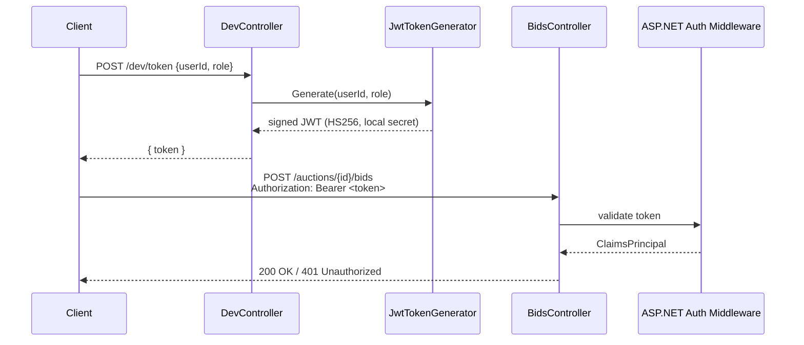
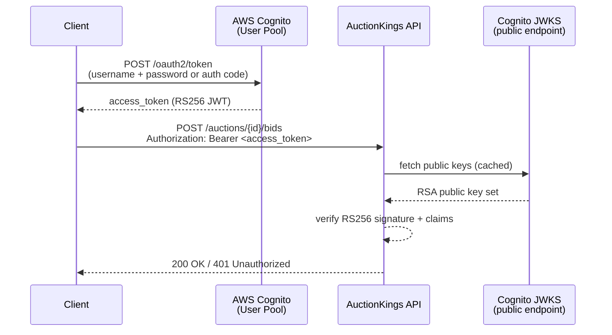

# AWS Cognito Integration Guide

## Overview

AuctionKings currently uses locally-generated JWTs (HMAC-SHA256, symmetric key) for authentication. This document describes how to replace that with **AWS Cognito User Pools** — an OAuth 2.0 / OpenID Connect identity provider that issues RS256-signed JWTs verified against Cognito's public JWKS endpoint.

The migration is backward-compatible at the ASP.NET Core middleware level: the only change is swapping the token validation source (local secret → remote JWKS). Policies, claims, and controller attributes remain untouched.

---

## Current Architecture



**Key files:**
- [`src/services/AuctionKings.API/Auth/JwtOptions.cs`](../src/services/AuctionKings.API/Auth/JwtOptions.cs) — `Jwt:Secret`, `Jwt:Issuer`, `Jwt:Audience`
- [`src/services/AuctionKings.API/Auth/JwtTokenGenerator.cs`](../src/services/AuctionKings.API/Auth/JwtTokenGenerator.cs) — local HS256 token generator (dev only)
- [`src/services/AuctionKings.API/Auth/Policies.cs`](../src/services/AuctionKings.API/Auth/Policies.cs) — `Bidder` / `Admin` policy constants
- [`src/services/AuctionKings.API/Program.cs`](../src/services/AuctionKings.API/Program.cs) — `AddJwtBearer` with `TokenValidationParameters`
- [`src/services/AuctionKings.API/Controllers/DevController.cs`](../src/services/AuctionKings.API/Controllers/DevController.cs) — dev-only token endpoint (disabled in Production)

---

## Target Architecture (Cognito)



Cognito issues **RS256** JWTs. The API validates them against the User Pool's public JWKS endpoint — no shared secret needed.

---

## AWS Cognito Concepts

| Concept | Description |
|---|---|
| **User Pool** | Directory of users. Manages sign-up, sign-in, MFA, password policies. |
| **App Client** | Credential set that allows an application to interact with the User Pool. Controls OAuth flows and token scopes. |
| **Identity Pool** | (Not used here) Maps authenticated users to AWS IAM roles for direct AWS resource access. |
| **JWKS endpoint** | `https://cognito-idp.<region>.amazonaws.com/<userPoolId>/.well-known/jwks.json` — public RSA keys used to verify token signatures. |
| **Access Token** | Short-lived JWT (default 1h) used to authorize API calls. Contains `sub`, `cognito:groups`, custom attributes. |
| **ID Token** | Contains user profile claims. Use the access token for API authorization — not the ID token. |
| **Groups** | Map to roles. A user in the `Admin` group gets `cognito:groups: ["Admin"]`. |

---

## Step-by-Step Migration

### Step 1 — Create the Cognito User Pool (AWS Console or CLI)

```bash
# Create User Pool
aws cognito-idp create-user-pool \
  --pool-name auction-kings-users \
  --policies "PasswordPolicy={MinimumLength=8,RequireUppercase=true,RequireLowercase=true,RequireNumbers=true}" \
  --auto-verified-attributes email \
  --region us-east-1

# Note the UserPoolId from the output (e.g. us-east-1_XXXXXXXXX)

# Create App Client (no client secret — SPA/mobile flow)
aws cognito-idp create-user-pool-client \
  --user-pool-id us-east-1_XXXXXXXXX \
  --client-name auction-kings-api \
  --no-generate-secret \
  --explicit-auth-flows ALLOW_USER_PASSWORD_AUTH ALLOW_REFRESH_TOKEN_AUTH \
  --region us-east-1

# Note the ClientId from the output
```

### Step 2 — Create Groups (maps to Bidder/Admin policies)

```bash
aws cognito-idp create-group --group-name Bidder --user-pool-id us-east-1_XXXXXXXXX --region us-east-1
aws cognito-idp create-group --group-name Admin  --user-pool-id us-east-1_XXXXXXXXX --region us-east-1
```

### Step 3 — Update `appsettings.json`

Replace the `Jwt` section with a `Cognito` section:

```json
{
  "Cognito": {
    "UserPoolId": "us-east-1_XXXXXXXXX",
    "ClientId": "YYYYYYYYYYYYYYYYYYYYYYYY",
    "Region": "us-east-1"
  }
}
```

The JWKS URL is derived at startup:
`https://cognito-idp.{Region}.amazonaws.com/{UserPoolId}/.well-known/jwks.json`

### Step 4 — Add NuGet Package

In `Directory.Packages.props`, add:

```xml
<PackageVersion Include="Microsoft.AspNetCore.Authentication.JwtBearer" Version="10.0.0" />
```

> This package is already referenced — no version change needed unless you want explicit Cognito-specific metadata helpers.

### Step 5 — Replace `AddJwtBearer` in `Program.cs`

**Before (local HS256):**

```csharp
builder.Services.AddAuthentication(JwtBearerDefaults.AuthenticationScheme)
    .AddJwtBearer(options =>
    {
        options.TokenValidationParameters = new TokenValidationParameters
        {
            ValidateIssuerSigningKey = true,
            IssuerSigningKey = new SymmetricSecurityKey(Encoding.UTF8.GetBytes(jwtOptions.Secret)),
            ValidIssuer = jwtOptions.Issuer,
            ValidAudience = jwtOptions.Audience,
            // ...
        };
    });
```

**After (Cognito RS256 via JWKS):**

```csharp
var cognitoOptions = builder.Configuration.GetSection("Cognito").Get<CognitoOptions>()
    ?? throw new InvalidOperationException("'Cognito' configuration section is missing.");

builder.Services.AddAuthentication(JwtBearerDefaults.AuthenticationScheme)
    .AddJwtBearer(options =>
    {
        options.Authority = $"https://cognito-idp.{cognitoOptions.Region}.amazonaws.com/{cognitoOptions.UserPoolId}";
        options.Audience = cognitoOptions.ClientId;
        options.TokenValidationParameters = new TokenValidationParameters
        {
            ValidateIssuer = true,
            ValidateAudience = false,   // Cognito access tokens use 'client_id', not 'aud'
            ValidateLifetime = true,
            ValidateIssuerSigningKey = true,
            // JWKS fetched automatically from options.Authority + /.well-known/jwks.json
        };
    });
```

> **Note:** Cognito access tokens set `client_id` instead of `aud`. Set `ValidateAudience = false` and validate `client_id` via a custom claim check, or switch to ID tokens (not recommended for API auth).

### Step 6 — Add `CognitoOptions` Class

Create `src/services/AuctionKings.API/Auth/CognitoOptions.cs`:

```csharp
namespace AuctionKings.API.Auth;

public sealed class CognitoOptions
{
    public const string SectionName = "Cognito";

    public string UserPoolId { get; init; } = string.Empty;
    public string ClientId { get; init; } = string.Empty;
    public string Region { get; init; } = string.Empty;
}
```

### Step 7 — Update Authorization Policies for Cognito Groups

Cognito puts group membership in the `cognito:groups` claim (not `ClaimTypes.Role`). Update `Program.cs`:

**Before:**
```csharp
options.AddPolicy(Policies.Bidder, policy => policy.RequireRole(Policies.Bidder));
options.AddPolicy(Policies.Admin,  policy => policy.RequireRole(Policies.Admin));
```

**After:**
```csharp
options.AddPolicy(Policies.Bidder, policy =>
    policy.RequireClaim("cognito:groups", Policies.Bidder));
options.AddPolicy(Policies.Admin, policy =>
    policy.RequireClaim("cognito:groups", Policies.Admin));
```

> Alternatively, configure a `RoleClaimType` on the token handler to map `cognito:groups` → `ClaimTypes.Role`, keeping the `RequireRole` calls untouched:
>
> ```csharp
> options.TokenValidationParameters.RoleClaimType = "cognito:groups";
> ```

### Step 8 — Remove or Guard `DevController`

The `DevController` generates local tokens for dev. With Cognito, use the AWS CLI or Cognito hosted UI to get tokens instead. Either remove `DevController` or keep it behind an environment guard (already done — `IsProduction()` returns 404).

For local dev against Cognito, use:

```bash
aws cognito-idp initiate-auth \
  --auth-flow USER_PASSWORD_AUTH \
  --client-id YYYYYYYYYYYYYYYYYYYYYYYY \
  --auth-parameters USERNAME=test@example.com,PASSWORD=Test@1234 \
  --region us-east-1
```

---

## Minimal POC Checklist

To verify the integration without full prod deployment:

- [ ] User Pool and App Client created in AWS (us-east-1 or preferred region)
- [ ] Test user created and added to `Bidder` group
- [ ] `CognitoOptions` class added ([`Auth/CognitoOptions.cs`](../src/services/AuctionKings.API/Auth/CognitoOptions.cs))
- [ ] `appsettings.Development.json` updated with `Cognito:UserPoolId`, `Cognito:ClientId`, `Cognito:Region`
- [ ] `Program.cs` updated to use `options.Authority` (JWKS discovery)
- [ ] Policies updated to use `cognito:groups` or `RoleClaimType` remapped
- [ ] `dotnet run` → `POST /auctions/{id}/bids` with Cognito access token returns 200
- [ ] Same endpoint without token returns 401
- [ ] User NOT in `Admin` group calling close-auction endpoint returns 403

---

## Security Considerations

| Topic | Local JWT | Cognito |
|---|---|---|
| Key type | HS256 (shared secret) | RS256 (asymmetric, private key never leaves Cognito) |
| Token issuance | API itself (`DevController`) | Cognito (separate service) |
| Key rotation | Manual | Automatic (Cognito rotates keys; JWKS discovery handles it) |
| User management | None (tokens for any GUID) | Full user lifecycle, MFA, password reset |
| Token revocation | Not supported | Supported via global sign-out |
| Secrets in config | Yes (`Jwt:Secret`) | No (only public UserPoolId + ClientId) |

---

## AWS Secrets Manager Integration (Production)

In production, store `Cognito:UserPoolId` and `Cognito:ClientId` in AWS Secrets Manager (they are not secret, but centralizing config is good practice). Sensitive values like DB connection strings and Redis passwords must use Secrets Manager.

```bash
aws secretsmanager create-secret \
  --name /auction-kings/cognito \
  --secret-string '{"UserPoolId":"us-east-1_XXXXXXXXX","ClientId":"YYYY...","Region":"us-east-1"}'
```

Use `AWSSDK.SecretsManager` with the `AddSecretsManager` configuration provider to load at startup:

```csharp
builder.Configuration.AddSecretsManager(configurator: opts =>
{
    opts.SecretFilter = entry => entry.Name.StartsWith("/auction-kings/");
    opts.KeyGenerator = (_, key) => key.Replace("/auction-kings/", "").Replace("/", ":");
});
```

---

## References

- [AWS Cognito Developer Guide — User Pools](https://docs.aws.amazon.com/cognito/latest/developerguide/cognito-user-identity-pools.html)
- [Validating Cognito JWTs](https://docs.aws.amazon.com/cognito/latest/developerguide/amazon-cognito-user-pools-using-tokens-verifying-a-jwt.html)
- [ASP.NET Core JWT Bearer Authentication](https://learn.microsoft.com/en-us/aspnet/core/security/authentication/jwt-authn)
- [`Microsoft.AspNetCore.Authentication.JwtBearer` — Authority-based JWKS discovery](https://learn.microsoft.com/en-us/dotnet/api/microsoft.aspnetcore.authentication.jwtbearer.jwtbeareroptions.authority)
- [Architecture decisions](decisions.md)
- [Architecture overview](architecture.md)
