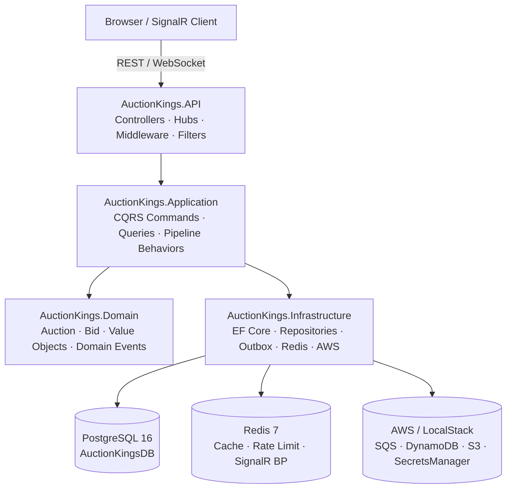

# Task 19 P0 — Security, Observability, DevOps & Docs Implementation Plan

> **For agentic workers:** REQUIRED SUB-SKILL: Use superpowers:subagent-driven-development (recommended) or superpowers:executing-plans to implement this plan task-by-task. Steps use checkbox (`- [ ]`) syntax for tracking.

**Goal:** Implement all P0 subtasks from Task19: JWT auth (ST01), Serilog structured logging (ST04), Dockerfile + docker-compose final (ST07), architecture.md (ST11), and demo script (ST13).

**Architecture:** ASP.NET Core 10 API with Clean Architecture. JWT authentication using local secrets for dev (no Cognito yet). Serilog replaces the default Microsoft logger with JSON output enriched with CorrelationId. Multi-stage Dockerfile targets `mcr.microsoft.com/dotnet/aspnet:10.0`. Docs live in `docs/`.

**Tech Stack:** .NET 10 / ASP.NET Core 10, Serilog.AspNetCore 9.x, Microsoft.AspNetCore.Authentication.JwtBearer 10.x, Docker multi-stage build, docker compose v2.

---

## File Map

| File                                                                  | Action | Responsible For                            |
| --------------------------------------------------------------------- | ------ | ------------------------------------------ |
| `Directory.Packages.props`                                            | Modify | Add Serilog + JwtBearer package versions   |
| `src/services/AuctionKings.API/AuctionKings.API.csproj`               | Modify | Reference new packages                     |
| `src/services/AuctionKings.API/appsettings.json`                      | Modify | Add Serilog config section                 |
| `src/services/AuctionKings.API/appsettings.Development.json`          | Modify | Add Jwt dev settings                       |
| `src/services/AuctionKings.API/Program.cs`                            | Modify | Wire Serilog + JWT auth                    |
| `src/services/AuctionKings.API/Auth/JwtTokenGenerator.cs`             | Create | Dev-only token generator                   |
| `src/services/AuctionKings.API/Controllers/DevController.cs`          | Create | `POST /dev/token` endpoint                 |
| `src/services/AuctionKings.API/Controllers/BidsController.cs`         | Modify | Add `[Authorize]` to PlaceBid              |
| `src/services/AuctionKings.API/Middleware/CorrelationIdMiddleware.cs` | Modify | Push CorrelationId into Serilog LogContext |
| `src/services/AuctionKings.API/Dockerfile`                            | Create | Multi-stage API Docker image               |
| `.dockerignore`                                                       | Create | Exclude bin/obj/secrets from image context |
| `docker/docker-compose.yml`                                           | Modify | Full compose: infra + api service          |
| `docs/architecture.md`                                                | Create | Interview-ready architecture doc           |
| `docs/demo-script.md`                                                 | Create | Repeatable 5-min demo                      |

---

## Task 1: Add Packages — Serilog + JwtBearer

**Files:**

- Modify: `Directory.Packages.props`
- Modify: `src/services/AuctionKings.API/AuctionKings.API.csproj`

- [ ] **Step 1.1: Add package versions to Directory.Packages.props**

Open `Directory.Packages.props`. Add a new `<ItemGroup Label="Logging">` section after the API group and a JWT entry in the API group:

```xml
  <ItemGroup Label="API">
    <PackageVersion Include="Microsoft.AspNetCore.OpenApi" Version="10.0.0" />
    <PackageVersion Include="Microsoft.AspNetCore.Authentication.JwtBearer" Version="10.0.0" />
    <PackageVersion Include="Microsoft.VisualStudio.Web.CodeGeneration.Design" Version="10.0.2" />
    <PackageVersion Include="Scalar.AspNetCore" Version="2.5.0" />
  </ItemGroup>

  <ItemGroup Label="Logging">
    <PackageVersion Include="Serilog.AspNetCore" Version="9.0.0" />
  </ItemGroup>
```

- [ ] **Step 1.2: Reference packages in API .csproj**

Open `src/services/AuctionKings.API/AuctionKings.API.csproj`. Add both references:

```xml
  <ItemGroup>
    <PackageReference Include="Microsoft.AspNetCore.Authentication.JwtBearer" />
    <PackageReference Include="Microsoft.AspNetCore.OpenApi" />
    <PackageReference Include="Microsoft.AspNetCore.SignalR.StackExchangeRedis" />
    <PackageReference Include="Microsoft.VisualStudio.Web.CodeGeneration.Design" />
    <PackageReference Include="Scalar.AspNetCore" />
    <PackageReference Include="Serilog.AspNetCore" />
  </ItemGroup>
```

- [ ] **Step 1.3: Restore and verify build**

```bash
cd /Users/giovannipellizzoni/source/course/auction-kings
dotnet restore && dotnet build src/services/AuctionKings.API/AuctionKings.API.csproj
```

Expected: `Build succeeded.`

- [ ] **Step 1.4: Commit**

```bash
git add Directory.Packages.props src/services/AuctionKings.API/AuctionKings.API.csproj
git commit -m "chore(packages): add Serilog.AspNetCore and JwtBearer packages"
```

---

## Task 2: Configure Serilog Structured Logging (ST04)

**Files:**

- Modify: `src/services/AuctionKings.API/appsettings.json`
- Modify: `src/services/AuctionKings.API/Middleware/CorrelationIdMiddleware.cs`
- Modify: `src/services/AuctionKings.API/Program.cs`

- [ ] **Step 2.1: Add Serilog configuration to appsettings.json**

Replace the entire contents of `src/services/AuctionKings.API/appsettings.json`:

```json
{
  "AllowedHosts": "*",
  "ConnectionStrings": {
    "DefaultConnection": "Host=localhost;Port=5432;Database=AuctionKingsDB;Username=dev;Password=",
    "Redis": "localhost:6379"
  },
  "Cache": {
    "ListingsTtl": "00:00:30",
    "DetailsTtl": "00:01:00",
    "CountersTtl": "00:00:05"
  },
  "RateLimit": {
    "MaxRequests": 10,
    "Window": "00:00:10"
  },
  "Serilog": {
    "MinimumLevel": {
      "Default": "Information",
      "Override": {
        "Microsoft.AspNetCore": "Warning",
        "Microsoft.EntityFrameworkCore": "Warning"
      }
    },
    "WriteTo": [
      {
        "Name": "Console",
        "Args": {
          "formatter": "Serilog.Formatting.Json.JsonFormatter, Serilog"
        }
      }
    ],
    "Enrich": ["FromLogContext", "WithMachineName", "WithThreadId"]
  }
}
```

- [ ] **Step 2.2: Update CorrelationIdMiddleware to push into Serilog LogContext**

Replace the contents of `src/services/AuctionKings.API/Middleware/CorrelationIdMiddleware.cs`:

```csharp
using Serilog.Context;

namespace AuctionKings.API.Middleware;

public sealed class CorrelationIdMiddleware(RequestDelegate next)
{
    public const string HeaderName = "X-Correlation-Id";

    public async Task InvokeAsync(HttpContext context)
    {
        var correlationId = context.Request.Headers.TryGetValue(HeaderName, out var value)
            ? value.ToString()
            : Guid.NewGuid().ToString();

        context.Response.Headers[HeaderName] = correlationId;

        using (LogContext.PushProperty("CorrelationId", correlationId))
        {
            await next(context);
        }
    }
}
```

- [ ] **Step 2.3: Wire Serilog in Program.cs**

Replace `var builder = WebApplication.CreateBuilder(args);` at the top of `Program.cs` with:

```csharp
using Serilog;

// ...rest of existing using statements...
```

And replace `var builder = WebApplication.CreateBuilder(args);` with:

```csharp
var builder = WebApplication.CreateBuilder(args);

builder.Host.UseSerilog((context, services, configuration) =>
    configuration.ReadFrom.Configuration(context.Configuration)
                 .ReadFrom.Services(services)
                 .Enrich.FromLogContext());
```

After `app.UseMiddleware<RequestLoggingMiddleware>();` add:

```csharp
app.UseSerilogRequestLogging(options =>
{
    options.EnrichDiagnosticContext = (diagnosticContext, httpContext) =>
    {
        diagnosticContext.Set("RequestHost", httpContext.Request.Host.Value);
        diagnosticContext.Set("UserAgent", httpContext.Request.Headers.UserAgent);
        if (httpContext.Response.Headers.TryGetValue(CorrelationIdMiddleware.HeaderName, out var cid))
            diagnosticContext.Set("CorrelationId", cid.ToString());
    };
});
```

- [ ] **Step 2.4: Build and verify**

```bash
dotnet build src/services/AuctionKings.API/AuctionKings.API.csproj
```

Expected: `Build succeeded.`

- [ ] **Step 2.5: Smoke-test log output**

```bash
dotnet run --project src/services/AuctionKings.API/AuctionKings.API.csproj &
sleep 3
curl -s http://localhost:5081/health/live
kill %1
```

Expected: Log lines are JSON objects with `"CorrelationId"` and `"RequestId"` fields.

- [ ] **Step 2.6: Commit**

```bash
git add src/services/AuctionKings.API/appsettings.json \
        src/services/AuctionKings.API/Middleware/CorrelationIdMiddleware.cs \
        src/services/AuctionKings.API/Program.cs
git commit -m "feat(observability): add Serilog structured JSON logging with CorrelationId enrichment"
```

---

## Task 3: Implement JWT Authentication (ST01)

**Files:**

- Modify: `src/services/AuctionKings.API/appsettings.Development.json`
- Create: `src/services/AuctionKings.API/Auth/JwtTokenGenerator.cs`
- Create: `src/services/AuctionKings.API/Controllers/DevController.cs`
- Modify: `src/services/AuctionKings.API/Program.cs`
- Modify: `src/services/AuctionKings.API/Controllers/BidsController.cs`

- [ ] **Step 3.1: Add Jwt settings to appsettings.Development.json**

Replace the entire contents of `src/services/AuctionKings.API/appsettings.Development.json`:

```json
{
  "Serilog": {
    "MinimumLevel": {
      "Default": "Debug",
      "Override": {
        "Microsoft.AspNetCore": "Information",
        "Microsoft.EntityFrameworkCore": "Warning"
      }
    }
  },
  "Jwt": {
    "Secret": "dev-only-secret-key-at-least-32-chars!!",
    "Issuer": "auction-kings-dev",
    "Audience": "auction-kings-dev",
    "ExpiresInMinutes": 60
  }
}
```

- [ ] **Step 3.2: Create Auth/JwtTokenGenerator.cs**

Create `src/services/AuctionKings.API/Auth/JwtTokenGenerator.cs`:

```csharp
using System.IdentityModel.Tokens.Jwt;
using System.Security.Claims;
using System.Text;
using Microsoft.IdentityModel.Tokens;

namespace AuctionKings.API.Auth;

public sealed class JwtTokenGenerator(IConfiguration configuration)
{
    public string Generate(Guid userId, string role)
    {
        var secret = configuration["Jwt:Secret"]
            ?? throw new InvalidOperationException("Jwt:Secret is not configured.");
        var issuer = configuration["Jwt:Issuer"]
            ?? throw new InvalidOperationException("Jwt:Issuer is not configured.");
        var audience = configuration["Jwt:Audience"]
            ?? throw new InvalidOperationException("Jwt:Audience is not configured.");
        var expiresInMinutes = configuration.GetValue<int>("Jwt:ExpiresInMinutes", 60);

        var key = new SymmetricSecurityKey(Encoding.UTF8.GetBytes(secret));
        var credentials = new SigningCredentials(key, SecurityAlgorithms.HmacSha256);

        var claims = new[]
        {
            new Claim(JwtRegisteredClaimNames.Sub, userId.ToString()),
            new Claim(JwtRegisteredClaimNames.Jti, Guid.NewGuid().ToString()),
            new Claim(ClaimTypes.Role, role),
        };

        var token = new JwtSecurityToken(
            issuer: issuer,
            audience: audience,
            claims: claims,
            expires: DateTime.UtcNow.AddMinutes(expiresInMinutes),
            signingCredentials: credentials
        );

        return new JwtSecurityTokenHandler().WriteToken(token);
    }
}
```

- [ ] **Step 3.3: Create Controllers/DevController.cs**

Create `src/services/AuctionKings.API/Controllers/DevController.cs`:

```csharp
using AuctionKings.API.Auth;
using Microsoft.AspNetCore.Mvc;

namespace AuctionKings.API.Controllers;

public sealed record TokenRequest(Guid UserId, string Role = "Bidder");
public sealed record TokenResponse(string Token);

/// <summary>Dev-only endpoint to generate JWT tokens. Not available in Production.</summary>
[Route("dev")]
[ApiController]
public sealed class DevController : ControllerBase
{
    private readonly JwtTokenGenerator _generator;
    private readonly IHostEnvironment _env;

    public DevController(JwtTokenGenerator generator, IHostEnvironment env)
    {
        _generator = generator;
        _env = env;
    }

    [HttpPost("token")]
    [ProducesResponseType(typeof(TokenResponse), StatusCodes.Status200OK)]
    [ProducesResponseType(StatusCodes.Status404NotFound)]
    public IActionResult GenerateToken([FromBody] TokenRequest request)
    {
        if (_env.IsProduction())
            return NotFound();

        var token = _generator.Generate(request.UserId, request.Role);
        return Ok(new TokenResponse(token));
    }
}
```

- [ ] **Step 3.4: Wire JWT authentication in Program.cs**

Add the following service registrations in `Program.cs` after `builder.Services.AddInfrastructure(builder.Configuration)`:

```csharp
// JWT Authentication
var jwtSecret = builder.Configuration["Jwt:Secret"]
    ?? throw new InvalidOperationException("Jwt:Secret is not configured.");
var jwtIssuer = builder.Configuration["Jwt:Issuer"]
    ?? throw new InvalidOperationException("Jwt:Issuer is not configured.");
var jwtAudience = builder.Configuration["Jwt:Audience"]
    ?? throw new InvalidOperationException("Jwt:Audience is not configured.");

builder.Services.AddAuthentication(options =>
{
    options.DefaultAuthenticateScheme = Microsoft.AspNetCore.Authentication.JwtBearer.JwtBearerDefaults.AuthenticationScheme;
    options.DefaultChallengeScheme = Microsoft.AspNetCore.Authentication.JwtBearer.JwtBearerDefaults.AuthenticationScheme;
})
.AddJwtBearer(options =>
{
    options.TokenValidationParameters = new Microsoft.IdentityModel.Tokens.TokenValidationParameters
    {
        ValidateIssuer = true,
        ValidateAudience = true,
        ValidateLifetime = true,
        ValidateIssuerSigningKey = true,
        ValidIssuer = jwtIssuer,
        ValidAudience = jwtAudience,
        IssuerSigningKey = new Microsoft.IdentityModel.Tokens.SymmetricSecurityKey(
            System.Text.Encoding.UTF8.GetBytes(jwtSecret)
        ),
    };
});
builder.Services.AddAuthorization();
builder.Services.AddSingleton<AuctionKings.API.Auth.JwtTokenGenerator>();
```

Note: `app.UseAuthentication()` and `app.UseAuthorization()` already exist in `Program.cs`.

- [ ] **Step 3.5: Add [Authorize] to BidsController.PlaceBid**

In `src/services/AuctionKings.API/Controllers/BidsController.cs`, add `[Authorize]` to the `PlaceBid` action:

```csharp
using Microsoft.AspNetCore.Authorization;

// ...

[HttpPost]
[Authorize]
[ProducesResponseType(typeof(Guid), StatusCodes.Status201Created)]
[ProducesResponseType(StatusCodes.Status400BadRequest)]
[ProducesResponseType(StatusCodes.Status401Unauthorized)]
[ProducesResponseType(StatusCodes.Status404NotFound)]
public async Task<IActionResult> PlaceBid(
```

- [ ] **Step 3.6: Build and verify**

```bash
dotnet build src/services/AuctionKings.API/AuctionKings.API.csproj
```

Expected: `Build succeeded.`

- [ ] **Step 3.7: Smoke-test auth**

Start infra first (`cd docker && docker compose -f docker-compose.infra.yml up -d`), then:

```bash
# Start API (in background)
dotnet run --project src/services/AuctionKings.API/AuctionKings.API.csproj &
sleep 5

# Should return 401 without token
curl -s -o /dev/null -w "%{http_code}" \
  -X POST http://localhost:5081/api/v1/auctions/00000000-0000-0000-0000-000000000001/bids \
  -H "Content-Type: application/json" \
  -H "X-Request-Id: test-001" \
  -d '{"bidderId":"00000000-0000-0000-0000-000000000002","amount":100,"currency":"USD"}'
# Expected: 401

# Get a token
TOKEN=$(curl -s -X POST http://localhost:5081/dev/token \
  -H "Content-Type: application/json" \
  -d '{"userId":"00000000-0000-0000-0000-000000000002","role":"Bidder"}' | jq -r .token)

echo "Token: $TOKEN"
# Expected: eyJ... (JWT string)

kill %1
```

- [ ] **Step 3.8: Commit**

```bash
git add src/services/AuctionKings.API/appsettings.Development.json \
        src/services/AuctionKings.API/Auth/JwtTokenGenerator.cs \
        src/services/AuctionKings.API/Controllers/DevController.cs \
        src/services/AuctionKings.API/Controllers/BidsController.cs \
        src/services/AuctionKings.API/Program.cs
git commit -m "feat(security): implement JWT local auth with dev token endpoint, protect PlaceBid"
```

---

## Task 4: Dockerfile + docker-compose Final (ST07)

**Files:**

- Create: `src/services/AuctionKings.API/Dockerfile`
- Create: `.dockerignore`
- Modify: `docker/docker-compose.yml`

- [ ] **Step 4.1: Create .dockerignore at repo root**

Create `/.dockerignore`:

```
**/.vs
**/.git
**/.gitignore
**/bin
**/obj
**/*.user
**/.env
**/docker/secrets
**/*.md
**/test
**/docs
```

- [ ] **Step 4.2: Create multi-stage Dockerfile**

Create `src/services/AuctionKings.API/Dockerfile`:

```dockerfile
# Build stage
FROM mcr.microsoft.com/dotnet/sdk:10.0 AS build
WORKDIR /repo

# Copy solution and project files for layer caching
COPY AuctionKings.sln .
COPY Directory.Build.props .
COPY Directory.Packages.props .
COPY src/common/AuctionKings.Shared/AuctionKings.Shared.csproj src/common/AuctionKings.Shared/
COPY src/services/AuctionKings.Domain/AuctionKings.Domain.csproj src/services/AuctionKings.Domain/
COPY src/services/AuctionKings.Application/AuctionKings.Application.csproj src/services/AuctionKings.Application/
COPY src/services/AuctionKings.Infrastructure/AuctionKings.Infrastructure.csproj src/services/AuctionKings.Infrastructure/
COPY src/services/AuctionKings.API/AuctionKings.API.csproj src/services/AuctionKings.API/

RUN dotnet restore src/services/AuctionKings.API/AuctionKings.API.csproj

# Copy source and publish
COPY src/ src/
RUN dotnet publish src/services/AuctionKings.API/AuctionKings.API.csproj \
    -c Release -o /app/publish --no-restore

# Runtime stage
FROM mcr.microsoft.com/dotnet/aspnet:10.0 AS runtime
WORKDIR /app

# Non-root user for security
RUN addgroup --system appgroup && adduser --system --ingroup appgroup appuser
USER appuser

COPY --from=build /app/publish .

ENV ASPNETCORE_URLS=http://+:8080
EXPOSE 8080

ENTRYPOINT ["dotnet", "AuctionKings.API.dll"]
```

- [ ] **Step 4.3: Verify Dockerfile builds locally**

```bash
cd /Users/giovannipellizzoni/source/course/auction-kings
docker build -f src/services/AuctionKings.API/Dockerfile -t auction-kings-api:local .
```

Expected: `Successfully built` (may take 2-3 minutes).

- [ ] **Step 4.4: Write docker-compose.yml (app + infra)**

The current `docker/docker-compose.yml` is a placeholder. Replace it entirely. This compose file extends the infra compose and adds the api service:

Create `docker/docker-compose.yml`:

```yaml
name: auction-kings

include:
  - docker-compose.infra.yml

services:
  api:
    image: auction-kings-api:local
    container_name: auction-kings-api
    build:
      context: ..
      dockerfile: src/services/AuctionKings.API/Dockerfile
    restart: unless-stopped
    environment:
      ASPNETCORE_ENVIRONMENT: Production
      ConnectionStrings__DefaultConnection: >-
        Host=postgres;Port=5432;Database=${POSTGRES_DB};Username=${POSTGRES_USER};
        Password=${POSTGRES_PASSWORD}
      ConnectionStrings__Redis: redis:6379,password=${REDIS_PASSWORD}
      Jwt__Secret: ${JWT_SECRET}
      Jwt__Issuer: auction-kings
      Jwt__Audience: auction-kings
      Jwt__ExpiresInMinutes: "60"
    depends_on:
      postgres:
        condition: service_healthy
      redis:
        condition: service_healthy
    networks:
      - backend
    healthcheck:
      test:
        ["CMD-SHELL", "curl -sf http://localhost:8080/health/live || exit 1"]
      interval: 10s
      timeout: 5s
      retries: 10
      start_period: 20s
    ports:
      - "5081:8080"
```

Note: `${POSTGRES_PASSWORD}` and `${REDIS_PASSWORD}` need to be set as plain env vars (not Docker secrets) for the API's connection strings. Add them to your `.env.local` file (already gitignored):

```
POSTGRES_USER=dev
POSTGRES_DB=AuctionKingsDB
POSTGRES_PASSWORD=<value from docker/secrets/postgres_password.txt>
REDIS_PASSWORD=<value from docker/secrets/redis_password.txt>
POSTGRES_HOST_PORT=5432
POSTGRES_CONTAINER_PORT=5432
REDIS_HOST_PORT=6379
REDIS_CONTAINER_PORT=6379
JWT_SECRET=dev-only-secret-key-at-least-32-chars!!
POSTGRES_PASSWORD_FILE=./secrets/postgres_password.txt
REDIS_PASSWORD_FILE=./secrets/redis_password.txt
```

- [ ] **Step 4.5: Verify compose up**

```bash
cd /Users/giovannipellizzoni/source/course/auction-kings/docker
docker compose -f docker-compose.yml up -d --build
sleep 30
curl -s http://localhost:5081/health/live
```

Expected: `Healthy` response.

```bash
docker compose -f docker-compose.yml down
```

- [ ] **Step 4.6: Commit**

```bash
cd /Users/giovannipellizzoni/source/course/auction-kings
git add src/services/AuctionKings.API/Dockerfile .dockerignore docker/docker-compose.yml
git commit -m "feat(devops): add multi-stage Dockerfile and full docker-compose with api service"
```

---

## Task 5: Write docs/architecture.md (ST11)

**Files:**

- Create: `docs/architecture.md`

- [ ] **Step 5.1: Create docs/architecture.md**

Create `docs/architecture.md` with the following content:

````markdown
# AuctionKings — Architecture

> Interview-ready architecture overview. For v2.0 roadmap and AWS deployment details see `/architecture/ARCHITECTURE.md`.

## Overview

AuctionKings is a real-time auction platform built with .NET 10, Clean Architecture, DDD, and CQRS. It handles high-concurrency bid submission, real-time notifications via SignalR, and guarantees event delivery with the Outbox Pattern.

---

## Layer Diagram



---

## Key Patterns & Decisions

### CQRS with MediatR

Commands and queries are separated handlers. Pipeline behaviors enforce cross-cutting concerns (validation, logging, idempotency) without polluting handlers.

| Component | File                                                       |
| --------- | ---------------------------------------------------------- |
| Commands  | `src/services/AuctionKings.Application/Auctions/Commands/` |
| Queries   | `src/services/AuctionKings.Application/Auctions/Queries/`  |
| Behaviors | `src/services/AuctionKings.Application/Behaviors/`         |

### Optimistic Concurrency with PostgreSQL `xmin`

`Auction.CurrentHighestBid` is updated with EF Core's `UseXminAsConcurrencyToken()`. If two bids land simultaneously, only one wins — the other gets a `DbUpdateConcurrencyException` mapped to a 409 Conflict, preserving correctness without locks.

**ADR:** Preferred over pessimistic locking because it has zero lock contention for the common case (non-concurrent bids) and scales well under moderate concurrency.

### Outbox Pattern (Transactional Messaging)

Domain events are persisted in the `OutboxMessages` table in the same DB transaction as the business operation. A background worker (`OutboxProcessor`) polls for unprocessed messages using `SKIP LOCKED` to allow parallel processing without double-delivery.

**ADR:** Preferred over direct SQS publish-in-transaction because SQS is not a transactional resource — publishing before commit risks orphan events; publishing after commit risks lost events. The Outbox eliminates both failure modes.

| Component     | File                                                               |
| ------------- | ------------------------------------------------------------------ |
| Outbox entity | `src/services/AuctionKings.Infrastructure/Outbox/OutboxMessage.cs` |
| Processor     | `src/workers/AuctionKings.BackgroundWorkers/OutboxProcessor.cs`    |

### Idempotency via `X-Request-Id`

All state-mutating requests require a client-generated `X-Request-Id` header. The `IdempotencyFilter` stores processed request IDs in Redis with a TTL. Duplicate requests return the original response.

**ADR:** Prevents duplicate bids from network retries — critical in auction systems where placing the same bid twice would give a bidder an unfair advantage.

### SignalR with Redis Backplane

`AuctionHub` pushes real-time bid updates and `NotificationHub` pushes winner notifications. The Redis backplane enables horizontal scaling across multiple API instances. `ConnectionTracker` maps users to connection IDs stored in Redis.

**SignalR Note:** `SignalRNotificationService` lives in the API project (not Infrastructure) to avoid a circular dependency — Infrastructure would need to reference SignalR, which references API.

### Rate Limiting with Redis

Distributed sliding-window rate limiter (`10 requests / 10s` default) protects `PlaceBid` from bid-flooding abuse. Backed by Redis so it works across multiple API instances.

### JWT Authentication (Local Dev)

Local HMAC-SHA256 JWTs for development. `POST /dev/token` (disabled in Production) issues tokens. Production path is AWS Cognito (see Roadmap).

---

## Infrastructure

| Service     | Local                   | Production               |
| ----------- | ----------------------- | ------------------------ |
| Database    | PostgreSQL 16 (Docker)  | Amazon RDS PostgreSQL 16 |
| Cache       | Redis 7 (Docker)        | Amazon ElastiCache Redis |
| Messaging   | LocalStack SQS/SNS      | Amazon SQS + SNS         |
| Event Store | LocalStack DynamoDB     | Amazon DynamoDB          |
| Secrets     | `docker/secrets/` files | AWS Secrets Manager      |
| Auth        | Local JWT               | AWS Cognito              |

---

## Health Endpoints

| Endpoint            | Checks                     |
| ------------------- | -------------------------- |
| `GET /health/live`  | Liveness (process alive)   |
| `GET /health/ready` | DB + Redis + Outbox lag    |
| `GET /health/db`    | Database connectivity only |

---

## AWS Roadmap

1. **Cognito** — replace local JWT with Cognito User Pool tokens
2. **ECS Fargate** — containerized API + worker deployment
3. **RDS + ElastiCache** — managed PostgreSQL and Redis
4. **SQS/SNS** — Outbox dispatcher → SQS for event fan-out
5. **CloudWatch + X-Ray** — structured logs → CloudWatch, traces via X-Ray
6. **Prometheus + Grafana** — metrics scraping in staging/prod

See `/architecture/ARCHITECTURE.md` for full v2.0 spec.

---

## Directory Structure

```
src/
  common/AuctionKings.Shared/          # Entity, AggregateRoot, Result<T>
  services/
    AuctionKings.Domain/               # Aggregates, VOs, Domain Events
    AuctionKings.Application/          # CQRS handlers, DTOs, behaviors
    AuctionKings.Infrastructure/       # EF Core, repos, outbox, Redis, AWS
    AuctionKings.API/                  # Controllers, hubs, middleware, filters
workers/
  AuctionKings.BackgroundWorkers/      # OutboxProcessor, AuctionCloseWorker
test/
  AuctionKings.UnitTests/
  AuctionKings.IntegrationTests/
  AuctionKings.ArchitectureTests/
  AuctionKings.LoadTests/
docker/
  docker-compose.infra.yml             # PostgreSQL, Redis, LocalStack, Moto
  docker-compose.yml                   # Full stack (infra + API)
docs/
  architecture.md                      # This file
  demo-script.md                       # 5-minute demo
```
````

- [ ] **Step 5.2: Commit**

```bash
git add docs/architecture.md
git commit -m "docs(architecture): add interview-ready architecture.md with ADRs and Mermaid diagram"
```

---

## Task 6: Write docs/demo-script.md (ST13)

**Files:**

- Create: `docs/demo-script.md`

- [ ] **Step 6.1: Create docs/demo-script.md**

Create `docs/demo-script.md`:

````markdown
# AuctionKings — 5-Minute Demo Script

Repeatable end-to-end demo: create auction → 3 bidder clients → 20 concurrent bids → observe real-time updates.

## Prerequisites

```bash
# 1. Docker running
docker info > /dev/null 2>&1 && echo "Docker OK"

# 2. Build and start full stack
cd /Users/giovannipellizzoni/source/course/auction-kings
docker build -f src/services/AuctionKings.API/Dockerfile -t auction-kings-api:local .
cd docker && docker compose -f docker-compose.yml up -d
cd ..

# 3. Wait for API health
until curl -sf http://localhost:5081/health/live; do sleep 2; done
echo "API ready"

# 4. Install jq if needed: brew install jq
```

---

## Step 1: Get Tokens for 3 Bidders (30 seconds)

```bash
BASE_URL=http://localhost:5081

# Create deterministic UUIDs for demo repeatability
SELLER_ID="11111111-1111-1111-1111-111111111111"
BIDDER1="22222222-2222-2222-2222-222222222222"
BIDDER2="33333333-3333-3333-3333-333333333333"
BIDDER3="44444444-4444-4444-4444-444444444444"

TOKEN1=$(curl -s -X POST $BASE_URL/dev/token \
  -H "Content-Type: application/json" \
  -d "{\"userId\":\"$BIDDER1\",\"role\":\"Bidder\"}" | jq -r .token)

TOKEN2=$(curl -s -X POST $BASE_URL/dev/token \
  -H "Content-Type: application/json" \
  -d "{\"userId\":\"$BIDDER2\",\"role\":\"Bidder\"}" | jq -r .token)

TOKEN3=$(curl -s -X POST $BASE_URL/dev/token \
  -H "Content-Type: application/json" \
  -d "{\"userId\":\"$BIDDER3\",\"role\":\"Bidder\"}" | jq -r .token)

echo "Tokens acquired for 3 bidders"
```

---

## Step 2: Create Auction (30 seconds)

```bash
AUCTION_RESPONSE=$(curl -s -X POST $BASE_URL/api/v1/auctions \
  -H "Content-Type: application/json" \
  -d "{
    \"title\": \"Rare Watch — Rolex Submariner 1966\",
    \"description\": \"Original bracelet, serviced 2024\",
    \"startingPrice\": 5000,
    \"currency\": \"USD\",
    \"durationInHours\": 0.5,
    \"sellerId\": \"$SELLER_ID\"
  }")

AUCTION_ID=$(echo $AUCTION_RESPONSE | jq -r '.')
echo "Auction created: $AUCTION_ID"
```

---

## Step 3: Verify Unauthorized Access (15 seconds)

```bash
# Without token — should return 401
STATUS=$(curl -s -o /dev/null -w "%{http_code}" \
  -X POST $BASE_URL/api/v1/auctions/$AUCTION_ID/bids \
  -H "Content-Type: application/json" \
  -H "X-Request-Id: unauth-test" \
  -d "{\"bidderId\":\"$BIDDER1\",\"amount\":5100,\"currency\":\"USD\"}")

echo "Without token: HTTP $STATUS (expected 401)"
```

---

## Step 4: Place 20 Concurrent Bids (1 minute)

```bash
# Fire 20 bids in parallel from 3 bidders, varying amounts
for i in $(seq 1 20); do
  BIDDER_VAR="TOKEN$((($i % 3) + 1))"
  AMOUNT=$((5000 + i * 100))
  BIDDER_ID_VAR="BIDDER$((($i % 3) + 1))"
  (
    curl -s -o /dev/null -w "Bid $i: HTTP %{http_code}\n" \
      -X POST $BASE_URL/api/v1/auctions/$AUCTION_ID/bids \
      -H "Content-Type: application/json" \
      -H "Authorization: Bearer ${!BIDDER_VAR}" \
      -H "X-Request-Id: demo-bid-$(uuidgen)" \
      -d "{\"bidderId\":\"${!BIDDER_ID_VAR}\",\"amount\":$AMOUNT,\"currency\":\"USD\"}"
  ) &
done
wait
echo "All 20 bid requests completed"
```

Expected: Mix of HTTP 201 (accepted) and HTTP 409 (concurrency conflict — normal and expected).

---

## Step 5: Inspect Results (30 seconds)

```bash
# List bids on the auction
curl -s "$BASE_URL/api/v1/auctions/$AUCTION_ID/bids?page=1&pageSize=20" | jq '.items | length'
# Expected: number of accepted bids

# Get auction detail — shows current highest bid
curl -s "$BASE_URL/api/v1/auctions/$AUCTION_ID" | jq '{title: .title, highestBid: .currentHighestBid, status: .status}'
```

---

## Step 6: Observe Logs (30 seconds)

```bash
# Tail API container logs — should show structured JSON with CorrelationId
docker logs auction-kings-api --tail 20 | jq '{timestamp: .Timestamp, level: .Level, msg: .MessageTemplate, cid: .CorrelationId}'
```

---

## Step 7: Check Health (15 seconds)

```bash
curl -s http://localhost:5081/health/ready | jq .
```

Expected: all checks `"Healthy"`.

---

## Teardown

```bash
cd docker && docker compose -f docker-compose.yml down
```

---

## SignalR Real-Time Demo (Optional, needs wscat)

```bash
# Install: npm install -g wscat
# Connect a SignalR client to auction hub
wscat -c "ws://localhost:5081/hubs/auction" \
  --header "Authorization: Bearer $TOKEN1"

# In another terminal, place a bid — the connected client receives BidPlaced event in real-time
```
````

- [ ] **Step 6.2: Commit**

```bash
git add docs/demo-script.md
git commit -m "docs(demo): add repeatable 5-minute demo script with curl commands"
```

---

## Final Verification

- [ ] **Run full test suite to confirm nothing regressed**

```bash
cd /Users/giovannipellizzoni/source/course/auction-kings
dotnet test --no-build
```

Expected: all tests pass (unit + integration + architecture tests).

- [ ] **Close GitHub issues**

```bash
env -u GITHUB_TOKEN gh issue close 49 54 67 70 72 \
  --repo PellizzoniCode/auction-kings \
  --comment "Implemented in Task 19 P0 batch"
```

---

## Self-Review Checklist

| ST   | Acceptance Criteria                                                             | Covered              |
| ---- | ------------------------------------------------------------------------------- | -------------------- |
| ST01 | `POST /bids` requires `Authorization: Bearer`                                   | Task 3, Step 3.5     |
| ST01 | Invalid/missing token returns 401                                               | Task 3, Step 3.7     |
| ST01 | Dev token via `POST /dev/token`                                                 | Task 3, Step 3.3     |
| ST04 | Logs in JSON on console                                                         | Task 2, Step 2.1     |
| ST04 | `RequestId` and `CorrelationId` in all request logs                             | Task 2, Step 2.2–2.3 |
| ST04 | Log level configurable via appsettings                                          | Task 2, Step 2.1     |
| ST07 | `docker compose up` starts PostgreSQL+Redis+LocalStack+API                      | Task 4, Step 4.4–4.5 |
| ST07 | Multi-stage Dockerfile (build→runtime)                                          | Task 4, Step 4.2     |
| ST07 | API healthy at `/health/live` after compose up                                  | Task 4, Step 4.5     |
| ST11 | Covers Clean Architecture, DDD, CQRS, Outbox, SignalR, concurrency, AWS roadmap | Task 5               |
| ST11 | Includes Mermaid diagram                                                        | Task 5               |
| ST13 | Create auction → 3 clients → 20 concurrent bids → logs                          | Task 6               |
| ST13 | Demo is repeatable (scripted curl commands)                                     | Task 6               |

